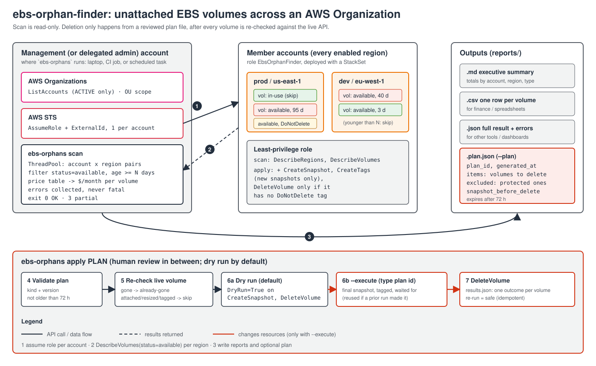

# ebs-orphan-finder

[](https://github.com/johnvega-cloud/ebs-orphan-finder/actions/workflows/ci.yml)

A Python + Boto3 tool that finds unattached EBS volumes older than N days in
every account of an AWS Organization, estimates what they cost, and writes a
report (Markdown, CSV, JSON). It can also write a deletion plan. Deleting is a
separate step: a person reviews the plan, the tool checks each volume again, and
it takes a final snapshot before it deletes.

## Problem it solves

When an instance is terminated, its non-root volumes are often left behind, and
so are volumes detached "for a minute" during a migration. They are in the
`available` state, attached to nothing, and still billed every month for their
full provisioned size, plus IOPS and throughput on io1/io2/gp3. In a single account you can
find them in the console. In an organization with dozens of accounts and 17+
regions, nobody does, and the cost grows quietly.

This tool answers three questions for the whole organization in one run:

1. **What** is unattached, where, and since when?
2. **How much** does it cost per month and per year, by account, region and type?
3. **What can be deleted safely**, and how do we delete it without losing data
   someone still needs?

## Architecture



1. **Accounts:** `organizations:ListAccounts` (only `ACTIVE` accounts),
   optionally narrowed to OUs (recursively), an explicit list, or exclusions.
2. **Credentials:** one `sts:AssumeRole` per member account (with an optional
   `ExternalId`). The account the tool runs in uses its own credentials.
3. **Regions:** every region *enabled in that account* (opt-in regions differ
   per account), or a fixed `--regions` list.
4. **Discovery:** `DescribeVolumes` filtered server-side on `status=available`,
   for every account/region pair in parallel (thread pool, adaptive retries
   for throttling). Volumes younger than `--min-age-days` are dropped.
5. **Cost:** each volume is priced from a versioned price table (size, plus
   provisioned IOPS and throughput where the type bills them).
6. **Output:** Markdown summary, CSV and JSON in `reports/`, and an optional
   deletion plan.
7. **Apply (separate command):** re-checks every volume, dry run by default,
   final snapshot, then delete.

See [docs/BUILD_GUIDE.md](docs/BUILD_GUIDE.md) for the build order and design
decisions, and [examples/sample-report.md](examples/sample-report.md) for a
sample report.

## Repository layout

```text
.
├── pyproject.toml              # package, pinned tool config (ruff, mypy, pytest, coverage)
├── src/ebs_orphans/
│   ├── cli.py                  # `ebs-orphans scan` / `ebs-orphans apply`, exit codes, logging
│   ├── accounts.py             # Organizations listing, OU recursion, AssumeRole session cache
│   ├── discovery.py            # parallel account x region scan, error collection
│   ├── pricing.py              # price table + cost per volume (tiered io2 IOPS, gp3 extras)
│   ├── report.py               # Markdown / CSV / JSON writers
│   ├── plan.py                 # deletion plan: build, validate, re-check, snapshot, delete
│   ├── models.py               # dataclasses: Account, OrphanVolume, ProtectRule, ScanResult
│   └── data/prices.json        # built-in EBS list prices (us-east-1)
├── tests/                      # pytest + moto: fake multi-account org, no real AWS
├── iam/                        # least-privilege policies (management, member scan, member cleanup)
├── deploy/member-role.yaml     # CloudFormation for the member role (deploy with a StackSet)
├── examples/                   # price override example, sample report
└── docs/                       # architecture diagram, build guide
```

## Prerequisites

- Python 3.11+.
- Credentials in the **management account** or an **Organizations delegated
  administrator** account, with [`iam/management-policy.json`](iam/management-policy.json).
  For a single account, `--current-account-only` needs no Organizations access.
- A role in every member account that trusts the scanner account:
  - **Recommended:** `EbsOrphanFinder`, from [`deploy/member-role.yaml`](deploy/member-role.yaml)
    deployed with a service-managed StackSet (instructions in the file). It is
    read-only unless you set `AllowCleanup=true`, and it requires an `ExternalId`.
    If your IAM policies only allow role names matching a pattern, set the
    `RoleName` parameter and pass the same name to `--role-name`.
  - **Quick start:** `OrganizationAccountAccessRole` (the default `--role-name`)
    exists in accounts created by Organizations, but it is full admin. Use it to
    try the tool, not for a scheduled job.

```bash
python3 -m venv .venv && source .venv/bin/activate
pip install .            # or: pip install -e ".[dev]" for development
```

## Usage

### Scan (read-only)

```bash
# Whole organization, all enabled regions, volumes created 30+ days ago
ebs-orphans scan --role-name EbsOrphanFinder --external-id "$EXTERNAL_ID"

# 90+ days, two regions, one OU, and write a deletion plan
ebs-orphans scan --min-age-days 90 --regions us-east-1,eu-west-1 \
  --ou ou-ab12-cdef3456 --role-name EbsOrphanFinder --external-id "$EXTERNAL_ID" --plan

# Just the account you are logged into
ebs-orphans scan --current-account-only --profile sandbox
```

Output in `reports/` (git-ignored: it contains account and resource IDs):

| File | For |
|---|---|
| `ebs-orphans-<timestamp>.md` | People: totals by account, region and type, top volumes by cost, errors |
| `ebs-orphans-<timestamp>.csv` | Finance / spreadsheets: one row per volume |
| `ebs-orphans-<timestamp>.json` | Tools: summary, every volume, every error |
| `ebs-orphans-<timestamp>.plan.json` | The deletion plan (only with `--plan`) |

The Markdown summary is also printed to stdout.

### Apply a plan

```bash
# 1. Dry run (default): re-checks every volume and calls the APIs with DryRun=True.
#    Nothing changes, and it proves the role has the permissions the real run needs.
ebs-orphans apply reports/ebs-orphans-20261015T120000Z.plan.json \
  --role-name EbsOrphanFinder --external-id "$EXTERNAL_ID"

# 2. For real. Asks you to type the plan id (use --yes in automation).
ebs-orphans apply reports/ebs-orphans-20261015T120000Z.plan.json --execute \
  --role-name EbsOrphanFinder --external-id "$EXTERNAL_ID"
```

Each run writes `<plan>.results.json` with one outcome per volume:

| Outcome | Meaning |
|---|---|
| `would-delete` | Dry run: checks passed and the role has the permissions needed |
| `deleted` | Final snapshot taken (unless the plan says not to), volume deleted |
| `already-gone` | The volume no longer exists, e.g. a re-run after an interruption |
| `skipped-changed` | Attached again, resized or replaced since the scan |
| `skipped-protected` | Has a protect tag now (the plan's tags or an extra `--protect-tag`) |
| `denied` | Dry run found a missing IAM permission |
| `error` | Anything else; details in the file. The volume was not deleted. |

### Options worth knowing

| Option | Default | Notes |
|---|---|---|
| `--min-age-days` | `30` | Age from `CreateTime` (see limitations) |
| `--protect-tag KEY[=VALUE]` | `DoNotDelete` | Repeatable. `KEY` alone matches any value except `false`/`no`/`0` |
| `--regions` | all enabled | Comma-separated |
| `--accounts` / `--exclude-accounts` / `--ou` | whole org | `--accounts` alone skips Organizations entirely |
| `--price-file` | built-in | JSON overrides: see [`examples/prices.override.json`](examples/prices.override.json) |
| `--no-snapshot` | snapshot on | Plan deletes without a final snapshot |
| `--max-workers` | `16` | Parallel account/region scans |
| `--max-plan-age-hours` | `72` | `apply` refuses older plans; `0` disables |
| `--log-format json` | text | Structured logs on stderr for log pipelines |

### Exit codes

| Code | Meaning |
|---|---|
| `0` | Success, nothing needs attention |
| `1` | Fatal: no credentials, or Organizations/STS failed before the scan started |
| `2` | Usage error, invalid or expired plan, confirmation refused |
| `3` | Finished, but some accounts/regions were not scanned, or some plan items were skipped/failed |

A scheduled job can alert on `3` without parsing the report.

## Safety

- **The scan is read-only.** It needs only `DescribeRegions` and `DescribeVolumes`.
- **Deleting is a separate step that needs a person:** a plan file, a dry run
  by default, `--execute`, and typing the plan id (or `--yes`).
- **The tool checks again before it acts.** `apply` re-reads every volume and
  skips it if it is attached, resized, replaced or newly protected. Plans
  expire after 72 hours.
- **Final snapshot by default**, tagged with the source volume, the plan id and
  the volume's own tags (owner, cost center), so the data can be restored and
  the snapshot traced back. The tool waits until the snapshot is `completed`
  before it deletes. If it does not finish in time, the volume is kept.
- **Protect tags, enforced twice.** Volumes with `DoNotDelete` (or your own
  `--protect-tag`) never get into a plan. On top of that, the cleanup IAM
  policy only allows `DeleteVolume` on volumes that have **no** `DoNotDelete`
  tag, so even a buggy plan cannot delete them. (Because IAM checks only that
  the key exists, a volume tagged `DoNotDelete=false` cannot be deleted through
  that role either: remove the tag instead.)
- **Least privilege:** separate scan and cleanup permissions, an `ExternalId` on
  the trust policy, and `CreateTags` allowed only on snapshots the role is
  creating.
- **Reports and plans are git-ignored**, because they contain account and
  resource IDs.

## Idempotency

- `scan` changes nothing, so it can run any number of times.
- `apply` can be re-run with the same plan. Volumes already deleted show up as
  `already-gone`. If a run stopped after the snapshot and before the delete,
  the next run finds that snapshot through its tags (`ebs-orphans:source-volume`
  + `ebs-orphans:plan-id`) and reuses it instead of making a second one.

## Cost model and limitations

- **Prices are list-price estimates** from [`src/ebs_orphans/data/prices.json`](src/ebs_orphans/data/prices.json)
  (us-east-1, retrieved 2026-10, source: the [EBS pricing page](https://aws.amazon.com/ebs/pricing/)).
  Regions not in the table use us-east-1 prices, and the report says so. Add
  regions or negotiated rates with `--price-file`. Savings Plans, EDP discounts
  and taxes are not included.
  - The gp3 throughput rate ($0.04 per MB/s-month above 125) is the one that is
    hardest to confirm: the AWS pricing page shows $0.06 in a worked example for
    an unnamed region. Check it against the AWS Pricing Calculator for your
    regions.
- **Volumes only:** the cost of existing snapshots is not counted. The final
  snapshot does cost something: it is stored incrementally at snapshot rates,
  usually much less than the volume.
- **Age is measured from `CreateTime`.** EC2 does not record when a volume was
  detached, so an old volume detached yesterday looks old. That is one reason
  deletion goes through a reviewed plan. For the real detach time, look up
  `DetachVolume` in CloudTrail (the event history keeps only 90 days).
- **Magnetic (`standard`) volumes** are priced on storage only. They bill per
  I/O too, but an unattached volume does no I/O.

## Development

```bash
pip install -e ".[dev]"
ruff check . && ruff format --check .
mypy
pytest                       # 69 tests, coverage gate 90%
```

The tests use [moto](https://github.com/getmoto/moto) to fake an organization
with a management account and two member accounts in memory: AssumeRole across
accounts, volumes in several regions, attached and protected volumes, plan
apply with snapshots, re-runs and interrupted runs. Paths moto cannot produce
(IAM denials in dry run, snapshot waiter timeouts) use a small fake EC2 client.
None of these automated tests touches real AWS; the manual real-account run is below.

### Tested against real AWS (2026-10-20, single account, us-east-1)

| Check | Result |
|---|---|
| `scan` over all 28 enabled regions | 27 scanned; `me-south-1` (endpoint unreachable) reported as a scan error, exit 3. 37 s with the explicit timeouts (it took ~20 min with botocore defaults, which led to the fix) |
| Plan with one orphan and one `DoNotDelete` volume | orphan listed, protected one excluded, cost $0.08/month (1 GiB gp3) |
| `apply` without `--execute` | `would-delete`, nothing changed |
| `DoNotDelete` added after the plan | `skipped-protected` at apply time |
| `apply --execute` | encrypted, tagged snapshot first, then delete |
| Same plan again | `already-gone`, no second snapshot |
| `member-role.yaml` deployed, `AllowCleanup=true` | AssumeRole denied without/with a wrong `ExternalId`; scan + snapshot + delete work with the role's permissions only; IAM denies `DeleteVolume` on a `DoNotDelete` volume even if the tool tried |

Not tested for real: scanning a second, active member account (the test organization had none).

CI ([`.github/workflows/ci.yml`](.github/workflows/ci.yml)) runs ruff, mypy
(strict), cfn-lint on the StackSet template, and pytest on Python 3.11 and
3.13, on every push and pull request. `main` is protected: changes go through
a PR and must pass CI.

## License

MIT
