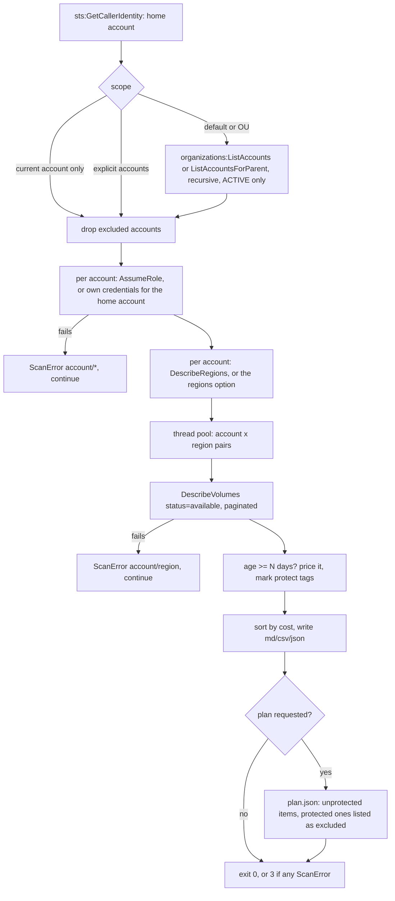
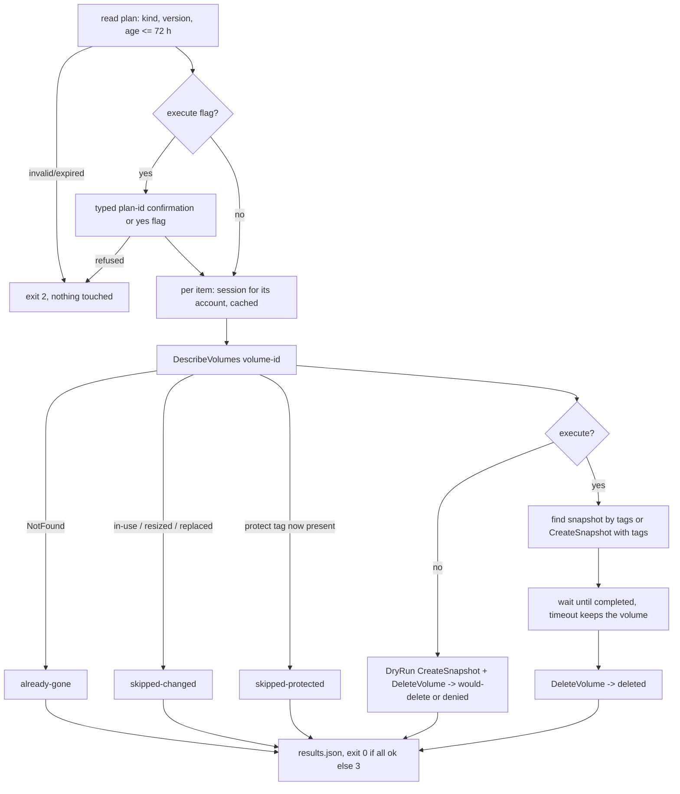

# Build guide: what gets built first, and why

This guide covers the project in two orders:

1. **Authoring order**: how to write this repository from scratch, step by step.
   Each step only depends on what the previous steps already defined.
2. **Execution order**: what happens, call by call, when the tool runs against
   an organization.

---

## 1. Authoring order (how to build the repository)

The commit history follows these steps, so `git log --reverse` shows the same path.

| Step | Files | What | Why it comes here |
|---|---|---|---|
| 0 | — | **Design on paper**: what counts as "orphan", how to reach every account, how to price a volume, how a deletion can go wrong | A cleanup tool that deletes the wrong volume is worse than none. The safety model (read-only scan, separate reviewed plan, re-check, snapshot) is decided before any code. |
| 1 | `.gitignore`, `pyproject.toml` | Skeleton, dependencies, ruff/mypy/pytest config | `reports/` and `*.plan.json` hold account and resource IDs: ignored **before** the first report exists. |
| 2 | `models.py` | `Account`, `OrphanVolume`, `ProtectRule`, `ScanError`, `ScanResult` | Every other module passes these around. Plain dataclasses keep reporting and planning independent of boto3 response shapes. |
| 3 | `pricing.py`, `data/prices.json` | Cost per volume | Pure function with no AWS calls: the easiest part to test exhaustively (gp3 baseline, io2 tiers, fallback region). |
| 4 | `accounts.py` | Organizations listing, OU recursion, AssumeRole session cache | Discovery needs a session per account before it can call EC2. |
| 5 | `discovery.py` | Parallel account x region scan with error collection | The core of the task. It depends on 2–4. |
| 6 | `report.py` | Markdown, CSV, JSON | Turns a `ScanResult` into something people and tools can use. |
| 7 | `plan.py` | Build, validate and apply a deletion plan | Deletion is optional and the riskiest part, so it comes after the read-only path works and is tested. |
| 8 | `cli.py` | `scan` / `apply`, exit codes, logging, confirmation | Thin layer: parse arguments, wire the modules together, choose an exit code. |
| 9 | `tests/` | moto multi-account org + fake EC2 for error paths | Locks in behaviour without AWS: cross-account access, filters, re-runs, interruptions, denials. |
| 10 | `iam/`, `deploy/member-role.yaml` | Least-privilege policies, StackSet role | The tool's permission needs are only known once the code is final. |
| 11 | `.github/workflows/ci.yml` | ruff, mypy, cfn-lint, pytest on 3.11 + 3.13 | Turns steps 2–10 into a gate: `main` only accepts changes that pass. |
| 12 | `README.md`, `docs/`, `examples/` | Usage, safety, limitations, diagram, sample report | Documents what was actually built, so it is written last. |

### Key decisions made in step 0

| Decision | Choice | Reason |
|---|---|---|
| What is "unattached" | `State == available`, filtered server-side (`Filters=status`) | That is exactly "not attached to any instance". Filtering in the API call returns fewer pages than filtering in Python. |
| How old | `now - CreateTime >= N days` | EC2 has no "detached at" field. CloudTrail does, but its event history only keeps 90 days and costs one lookup per volume. Documented as a limitation; the review step covers the gap. |
| Reaching accounts | One `AssumeRole` per account, cached; the home account uses its own credentials | The management account has no `OrganizationAccountAccessRole` of its own. One assume per account, not per region, keeps STS calls low. |
| Which regions | `DescribeRegions` **per account** | Opt-in regions are enabled per account. A list taken from the management account can miss regions or include ones a member has not enabled. |
| Concurrency | `ThreadPoolExecutor` over account x region pairs, adaptive retries | The work waits on I/O, so threads fit. Adaptive retry mode slows down by itself when AWS throttles. |
| Failure model | Collect per-account/per-region errors, keep going, exit `3` | One locked-down account must not hide the other 49. The report lists what was **not** scanned. |
| Pricing | Versioned JSON table, `--price-file` overrides, `price_source` on every volume | Reviewable in a PR, works offline and in tests, no Pricing API permissions. The report flags fallback prices instead of hiding them. |
| Delete or not | The scan never deletes. A **plan file** is the hand-off. | Separates "what we found" from "what we agreed to delete". The plan can be attached to a change ticket. |
| Apply safety | Plan expiry, live re-check, DryRun by default, typed confirmation, final snapshot, IAM tag condition | Every layer covers a different failure: stale data, a re-attached volume, missing permissions, a slip of the finger, needing the data later, a bug in the tool. |
| Idempotency of apply | Snapshot looked up by tags `source-volume` + `plan-id` before creating one; `NotFound` = `already-gone` | An interrupted run can be repeated without duplicate snapshots or errors. |
| CLI library | `argparse` (standard library) | One runtime dependency (`boto3`) is easier to audit and install on a locked-down admin host. |
| Test strategy | moto for the whole flow, a tiny fake client for IAM denials and waiter timeouts | moto models multi-account AssumeRole and EC2 well, but it does not enforce IAM. |

---

## 2. Execution order (what happens on each run)

### `ebs-orphans scan`

### `ebs-orphans apply PLAN`

